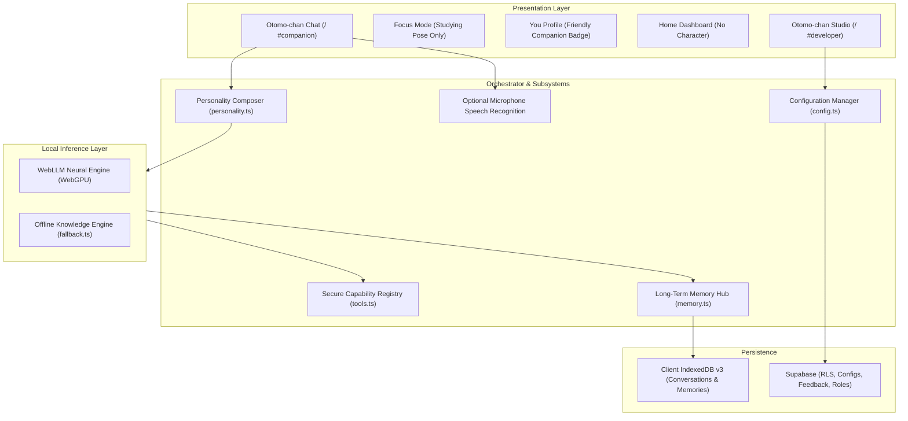

# Otomo-chan: System Architecture, Configuration & Operation Guide

Welcome to the comprehensive technical documentation for **Otomo-chan (お供ちゃん)** — the intelligent, anime-inspired student companion seamlessly integrated into **Otomo**.

---

## 1. System Overview & Architecture

Otomo-chan is designed with a modular architecture. Her personality and inference are configurable; responses are text-only. Speech recognition is an optional user input method and does not provide spoken AI replies.



---

## 2. Character Placement System

Adheres strictly to the visual placement rules:
1. **Home Page (`src/views/Home.tsx`)**:
   - Otomo-chan is **completely hidden** on the Home dashboard to keep the student focused on immediate schedule and lecture alerts.
2. **Focus Page (`src/views/Study.tsx`)**:
   - Displays **ONLY her dedicated studying pose** (`mood="studying"`).
   - Animates with subtle breathing and notebook focus movements without distracting the student.
3. **Otomo-chan Chat View (`src/views/Companion.tsx`)**:
   - Full interactive character presence with dynamic expressive states:
     - `idle`: Calm floating / ready
     - `thinking`: Reasoning indicator while generating
     - `listening`: Responsive pulse when the microphone is recording
     - `happy`: Positive feedback or cleared tasks
     - `confused`: Uncertainty / clarifying questions
     - `explaining`: Structured tutoring / walkthroughs
4. **You Page (`src/views/Settings.tsx`)**:
   - Integrated anime companion passport card in a balanced, friendly pose (`mood="welcome"`).

---

## 3. Microphone Input (Text Replies Only)

- Otomo-chan's replies are displayed as text; the app does not synthesize or play spoken AI responses.
- Students can tap the microphone button in Companion to dictate a question when the browser supports the Web Speech Recognition API.
- Microphone access starts only after the user explicitly taps the button. The recognized transcript is submitted as a regular chat message.
- Speech recognition availability and language support depend on the browser and may require an internet connection.

---

## 4. Local AI Inference & Offline Architecture

Otomo-chan operates **100% free of paid APIs** using browser-native open-source technologies:

### Neural WebGPU Inference (`@mlc-ai/web-llm`):
- Supported models:
  - `Qwen2.5-0.5B-Instruct-q4f16_1-MLC` (~350 MB download — recommended default for 4–8 GB RAM devices).
  - `SmolLM2-360M-Instruct-q4f16_1-MLC` (~200 MB download — ultra-fast for low-end laptops and phones).
  - `Qwen2.5-1.5B-Instruct-q4f16_1-MLC` (~1 GB download — advanced reasoning for 8 GB+ workstations).
- Weights are downloaded once and cached in the browser's Cache API / IndexedDB.
- Code-split into a separate chunk (`dist/assets/web-llm-*.js`) via Vite so Home page load time is untouched.

### Offline Companion Fallback Engine (`src/lib/otomo/fallback.ts`):
- When WebGPU is not supported or before the user downloads a model, the offline fallback engine seamlessly answers:
  - Class schedules & timetable lookups
  - Pending tasks and homework
  - Pomodoro focus session status
  - Exam dates and locations
  - Core academic explanations (calculus, Python, binary search)
  - Arabic language assistance

---

## 5. Long-Term Student Memory & Privacy

Located in `src/lib/otomo/memory.ts`:
- Stored locally in IndexedDB (`memories` store) independently of chat messages.
- Categorized into: `preference`, `academic`, `goal`, `project`, and `fact`.
- Deleting conversations **never deletes student memories**.
- **Student Privacy Controls**:
  - Open the **You** page (`Settings.tsx`).
  - Click **Manage Memories**.
  - Students can review everything Otomo-chan has remembered, edit details, toggle active/inactive, or purge all memories at any time.

---

## 6. Suggestions & Complaints System

Located in `src/lib/feedback.ts` and `src/components/FeedbackModal.tsx`:
- Accessible from the prominent **Suggestions & Complaints** button on the You page.
- Fields:
  - Category: `Suggestion`, `Complaint`, `Bug Report`, `Other`.
  - Subject and detailed description.
  - Optional screenshot / attachment (PNG, JPEG, WebP up to 5 MB).
  - Contact preference (In-App, Email, Anonymous).
  - Automatically tagged with the student's authenticated user ID.
- **Student Tracking**:
  - Students can click "My Submissions" to see status badges (`New`, `Under Review`, `In Progress`, `Responded`, `Resolved`).
  - View the developer's reply directly inside the app.
- **Admin Feedback Desk in Studio**:
  - View all incoming submissions.
  - Filter by status and type.
  - Write replies and update statuses.

---

## 7. Developer Studio (`/ #developer`)

Accessible to administrators to configure and evolve Otomo-chan:
- **Identity**: Change character name, title, description, and primary language.
- **Personality**: Sliders for Friendliness, Playfulness, Humor, Formality, and Enthusiasm, plus custom directives.
- **AI Brain**: Select available models, temperature, top-p, and token limits.
- **Speech input**: Use browser speech recognition to dictate questions; AI replies remain text-only.
- **Knowledge Base**: Upload university regulations, exam rules, and syllabi.
- **Memory Rules**: Configure consolidation policies and category filters.
- **Capabilities**: Enable/disable application tools (Schedule, Tasks, Focus Timer).
- **Versions**: Version history, rollback to previous versions, and one-click publishing.

---

## 8. Database Migrations & Supabase Setup

The migration file is located at `supabase/migrations/0006_otomo_chan_and_feedback.sql`.

### How to apply the migration:
1. Log in to your [Supabase Dashboard](https://supabase.com/dashboard).
2. Go to the **SQL Editor** tab.
3. Paste the contents of `supabase/migrations/0006_otomo_chan_and_feedback.sql`.
4. Click **Run**.

Rerun migration `0006` after making changes to this file or when upgrading an existing database: the migration uses conditional creation and policy replacement, so it is safe to execute again. Apply migrations `0001`–`0005` only if they have not already been applied.

### How to authorize an Administrator:
Run this SQL query in the Supabase SQL Editor:
```sql
-- Replace with the user's UUID from auth.users
insert into public.user_roles (id, role)
values ('YOUR-USER-UUID-HERE', 'admin')
on conflict (id) do update set role = 'admin';
```

---

## 9. Verification & Testing Checklist

- [x] **Type Safety**: `npm run typecheck` passes with zero errors.
- [x] **Production Build**: `npm run build` succeeds; `@mlc-ai/web-llm` is code-split cleanly.
- [x] **Home Placement**: Zero character avatars on the Home dashboard.
- [x] **Focus Placement**: Only dedicated studying pose rendered in Focus mode.
- [x] **Chat Presence**: Full interactive expressions (Idle, Thinking, Listening, Speaking, Explaining).
- [x] **Offline Capability**: Fallback engine answers timetable and tasks without internet.
- [x] **Microphone Input**: Explicitly activated browser speech recognition can dictate user messages; no text-to-speech response is used.
- [x] **Student Feedback**: Form, attachment upload, history viewer, and admin reply desk verified.

---

## 10. PWA Updates & Search Console

### Deploying an app update
1. Update `src/lib/version.ts` and `package.json` to the new release version.
2. Run `npm run build` and deploy `dist/` through Vercel.
3. The service worker checks for an update when the app opens, every 15 minutes while visible, and when the tab becomes visible again.
4. Existing users see the Otomo update banner. **Update** activates the new service worker and reloads; **Later** postpones the prompt.
5. After the update reloads, new users may see the What's New sheet because `4.0.0` differs from the saved `uh:seen-version` value.

### Submitting the sitemap to Google Search Console
1. Open [Google Search Console](https://search.google.com/search-console).
2. Add `https://ejust-otomo.vercel.app/` as a **Domain** or **URL-prefix** property.
3. Verify ownership using a DNS TXT record for a Domain property, or the HTML-file/meta-tag/DNS method for a URL-prefix property.
4. Open **Sitemaps** under the verified property.
5. Enter `https://ejust-otomo.vercel.app/sitemap.xml` or submit only `sitemap.xml` as the form value.
6. Click **Submit**, then use **URL Inspection** to request indexing for `https://ejust-otomo.vercel.app/`.
7. Google indexing is not immediate; monitor **Sitemaps**, **Page indexing**, and **URL Inspection** over the following days.

The sitemap and robots declaration are served from `public/sitemap.xml` and `public/robots.txt`.
